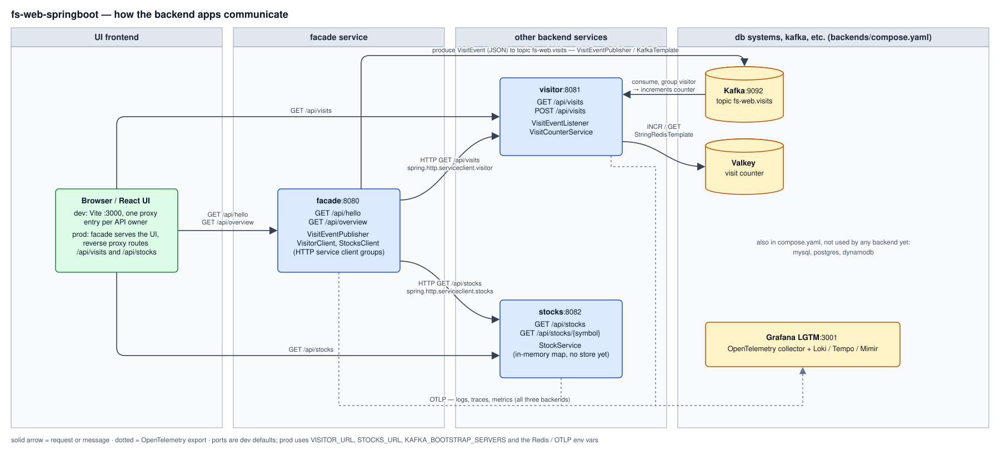

# Backend communication

How the three Spring Boot backends talk to each other, to the browser and to the Docker Compose services, as a swim-lane diagram with four lanes: UI frontend, facade service, other backend services, and db systems / Kafka / observability.

`backend-communication.svg` is a hand-written SVG (absolute coordinates, no generator); edit it directly and check it in a browser or IntelliJ.

## Paths

| From    | To      | How                                                                                                                      | Trigger                                    |
|---------|---------|--------------------------------------------------------------------------------------------------------------------------|--------------------------------------------|
| Browser | facade  | HTTP `GET /api/hello`, `GET /api/overview`                                                                               | UI; Vite proxy in dev, same origin in prod |
| Browser | visitor | HTTP `GET /api/visits`                                                                                                   | Vite proxy in dev, reverse proxy in prod   |
| Browser | stocks  | HTTP `GET /api/stocks`                                                                                                   | Vite proxy in dev, reverse proxy in prod   |
| facade  | Kafka   | Produce `VisitEvent` JSON to topic `fs-web.visits` (`VisitEventPublisher`, `KafkaTemplate`)                              | Every `GET /api/hello`                     |
| Kafka   | visitor | `VisitEventListener` (`@KafkaListener`, group `visitor`) increments the counter                                          | Each record on `fs-web.visits`             |
| facade  | visitor | HTTP `GET /api/visits` via `VisitorApi` (`spring.http.serviceclient.visitor.base-url`, default `http://localhost:8081`) | `GET /api/overview`                        |
| facade  | stocks  | HTTP `GET /api/stocks` via `StocksApi` (`spring.http.serviceclient.stocks.base-url`, default `http://localhost:8082`)   | `GET /api/overview`                        |
| visitor | Valkey  | `StringRedisTemplate` INCR / GET (`VisitCounterService`)                                                                 | Kafka record or `POST /api/visits`         |
| all     | LGTM    | OTLP logs, traces and metrics                                                                                            | Always; endpoint from Docker Compose in dev |

Notes:

- `facade` never calls `visitor` over HTTP for a visit: `/api/hello` only publishes to Kafka (`docs/011-kafka-visit-events.md`).
- The `stocks` backend keeps its list in memory; no data store yet (`docs/009-stocks-service.md`).
- `mysql`, `postgres` and `dynamodb` are in `compose.yaml` but no backend uses them yet (`docs/008-mysql-postgres-dynamodb-compose.md`).
- Production hosts come from env vars: `KAFKA_BOOTSTRAP_SERVERS`, `VISITOR_URL`, `STOCKS_URL`, and the Redis and OTLP settings in each `application-prod.yml`.
